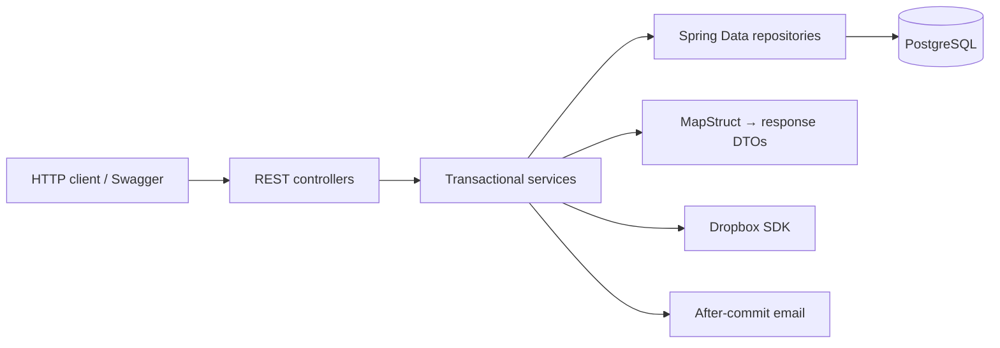

# Task Management API

> Turn project plans into assigned, organized and trackable team tasks.

[](pom.xml)
[](pom.xml)
[](src/main/java/com/example/taskmanagement/mapper/ResponseMapper.java)
[](compose.yaml)
[](pom.xml)

A focused Spring Boot REST API for managing projects, assigning tasks, sharing
Dropbox attachments and discussing work. JWT authentication protects project data;
email keeps assignees informed about assignments, comments and approaching deadlines.

**Start here:** [Run the application](#quick-start) · [Try the API](#first-request)
· [Explore the architecture](documentation/ARCHITECTURE.md) · [Course checklist](documentation/COURSE_CHECKLIST.md)

## What you can do

| Area | Capabilities |
|---|---|
| Accounts | Register, sign in, edit a profile and manage USER/ADMIN roles |
| Projects | Create projects, maintain membership, update status and control access |
| Tasks | Assign work, set priority/status/due dates and attach labels |
| Collaboration | Add and delete comments; share and download files through Dropbox |
| Search | Combine name, status, priority, assignee, label and date filters |
| Notifications | Receive assignment/comment emails and daily deadline reminders |

Six JPA models, seven REST controllers and a conventional service/repository structure
keep the code easy to follow. Swagger provides the interactive browser interface.

## Quick start

**Prerequisites:** Docker Compose. Java 21 is needed when running Maven or the jar locally.

1. Create a local configuration file:

   ```powershell
   Copy-Item .env.sample .env.course
   ```

2. Edit `.env.course`: set `POSTGRES_PASSWORD`, a random Base64 JWT key containing
   at least 32 bytes, and `DROPBOX_ACCESS_TOKEN`. See the
   [configuration guide](documentation/OPERATIONS.md#configuration) for key generation,
   Dropbox refresh tokens and SMTP settings.
3. Build and start the application with its database and local email inbox:

   ```powershell
   docker compose --env-file .env.course up --build -d
   ```

| Service | Default address |
|---|---|
| Swagger UI | http://127.0.0.1:8081/swagger-ui/index.html |
| OpenAPI JSON | http://127.0.0.1:8081/v3/api-docs |
| Database health | http://127.0.0.1:8081/actuator/health |
| Local email inbox | http://127.0.0.1:8026 |

The application requires a **new, empty course database**. Compose uses a separate
`task-management-course` project and database volume. `.env.course` is ignored by Git;
the application does not import the existing product `.env`.

## First request

In Swagger, execute `POST /api/auth/register`:

```json
{
  "username": "alice",
  "password": "choose-a-strong-password",
  "email": "alice@example.com",
  "firstName": "Alice",
  "lastName": "Smith"
}
```

Then call `POST /api/auth/login`:

```json
{ "identifier": "alice", "password": "choose-a-strong-password" }
```

Copy `accessToken` into Swagger's **Authorize** dialog. Protected HTTP requests use
`Authorization: Bearer <accessToken>`. Tokens expire after 15 minutes.
Continue with the [project → task → comment → attachment walkthrough](documentation/API.md#walkthrough).

## How it is built



| Technology | Purpose |
|---|---|
| Java 21 / Spring Boot 4.1.1 | Application runtime and HTTP API |
| Spring Security / BCrypt / JWT | Authentication, password hashing and access control |
| Spring Data JPA / PostgreSQL 17 | Persistence, pagination and query filters |
| Liquibase | Versioned schema migration; Hibernate uses `ddl-auto=validate` |
| MapStruct 1.6.3 | Generated Spring mappers, nested/collection mappings and entity updates |
| Dropbox SDK / Spring Mail | File storage and email delivery |
| JUnit / Mockito / JaCoCo / Checkstyle | Behavioral checks, coverage and style |

MapStruct is used in running application paths, including all six response models
and label creation/update. See the [mapping walkthrough](documentation/ARCHITECTURE.md#mapstruct-in-practice).

## Build and verification

```powershell
.\mvnw.cmd clean verify
```

Linux/macOS: `./mvnw clean verify`. Maven Wrapper downloads Maven automatically.
Local tests use H2 in PostgreSQL mode and require neither real provider credentials
nor a running Docker daemon. JaCoCo enforces **at least 60% line coverage**;
the report is written to `target/site/jacoco/index.html`.

[GitHub Actions](.github/workflows/ci.yml) repeats verification on PostgreSQL, then
checks packaged startup/restart and Docker build/start/restart. Dropbox and SMTP
are substituted in automated tests; live integration acceptance is a separate step.

## Documentation

- [API reference](documentation/API.md): routes, example bodies, filters and access rules.
- [Architecture](documentation/ARCHITECTURE.md): package map, data relationships, MapStruct and transactions.
- [Spring lifecycle](documentation/SPRING_LIFECYCLE.md): singleton choices, initialization dependencies and AOP.
- [Code review](documentation/CODE_REVIEW.md): fixed findings, Hibernate ownership and measured fetch plans.
- [Operations](documentation/OPERATIONS.md): configuration, local execution, testing and troubleshooting.
- [Course checklist](documentation/COURSE_CHECKLIST.md): implemented requirements, contract differences and remaining evidence.

## Scope and delivery

This standalone course repository publishes its submission on `main`; it was
exported from the extended product's `course/submission` branch. The extended
product is preserved separately; this application does not migrate its data. Frontend,
graph planning, resource calendars, time tracking and extra storage/notification
providers are outside this version.

Email is best effort after commit. Deadline reminders run at **09:00 UTC** for open
assigned tasks due today or tomorrow. Durable retries, restart catch-up and
multi-instance reminder deduplication are not implemented.

For a new GitHub repository, export the tested files and initialize a new repository
as described in [submission export](documentation/OPERATIONS.md#export-to-a-new-repository).
Live Dropbox/SMTP checks, load measurements and repository process requirements
are tracked explicitly in the course checklist.
