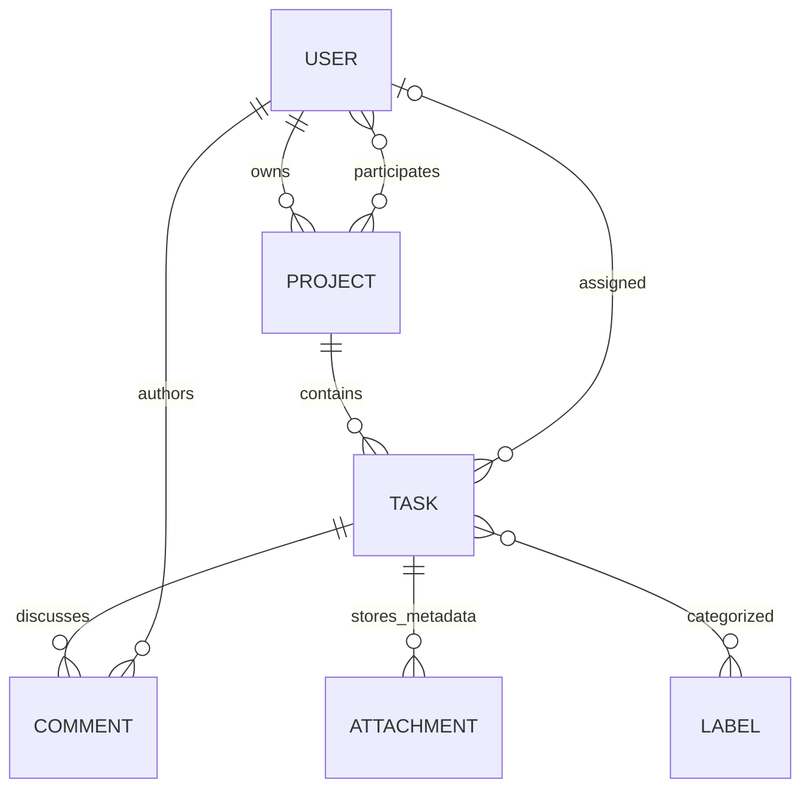

# Architecture and code walkthrough

[README](../README.md) · [API](API.md) · [Operations](OPERATIONS.md) · [Course checklist](COURSE_CHECKLIST.md)

## Design

One Spring Boot application and one relational database implement the assignment.
Controllers handle HTTP, services enforce business rules inside transactions,
repositories access data, and MapStruct converts entities into response records.
There are no module ports, planning engines or alternate storage providers.

| Package | Responsibility | Start reading |
|---|---|---|
| `controller` | Validated HTTP requests, status codes and authenticated actor IDs | [TaskController](../src/main/java/com/example/taskmanagement/controller/TaskController.java) |
| `service` | CRUD, authorization and integrations | [TaskService](../src/main/java/com/example/taskmanagement/service/TaskService.java) |
| `repository` | Spring Data queries, pagination and project locking | [TaskRepository](../src/main/java/com/example/taskmanagement/repository/TaskRepository.java) |
| `model` | Six JPA entities and assignment enums | [Task](../src/main/java/com/example/taskmanagement/model/Task.java) |
| `dto` | Validated requests, filters and response records | [TaskRequest](../src/main/java/com/example/taskmanagement/dto/TaskRequest.java) |
| `mapper` | Compile-time entity/DTO transformations | [ResponseMapper](../src/main/java/com/example/taskmanagement/mapper/ResponseMapper.java) |
| `security` | JWT validation, live roles and BCrypt login | [SecurityConfig](../src/main/java/com/example/taskmanagement/security/SecurityConfig.java) |
| `config` | UTC clock, Dropbox client, async email and OpenAPI | [ApplicationConfig](../src/main/java/com/example/taskmanagement/config/ApplicationConfig.java) |
| `exception` | Safe HTTP problem responses | [GlobalExceptionHandler](../src/main/java/com/example/taskmanagement/exception/GlobalExceptionHandler.java) |

## Data model



Project membership and task labels use join tables. Entities use lazy associations
and optimistic `version` fields; DTOs expose association IDs rather than persistence
objects. Comments and attachments use `LocalDateTime` interpreted as UTC. Project
dates and task due dates use `LocalDate`.

[The initial migration](../src/main/resources/db/changelog/001-course-schema.sql)
defines foreign keys, enum constraints, uniqueness and retrieval indexes. Both
application tables and Liquibase tracking are in `public`; Hibernate validates the
schema instead of changing it at startup.

## MapStruct in practice

[ResponseMapper](../src/main/java/com/example/taskmanagement/mapper/ResponseMapper.java)
is a MapStruct interface injected into the services as a Spring bean. Maven runs
`mapstruct-processor` during compilation and generates `ResponseMapperImpl` under
`target/generated-sources/annotations`. Generated sources are build output.

```java
@Mapper(componentModel = MappingConstants.ComponentModel.SPRING,
        unmappedTargetPolicy = ReportingPolicy.ERROR)
public interface ResponseMapper {
    @Mapping(target = "projectId", source = "project.id")
    @Mapping(target = "assigneeId", source = "assignee.id")
    @Mapping(target = "labelIds", source = "labels")
    TaskResponse toResponse(Task task);
}
```

The complete mapper demonstrates:

- Convention-based mapping into Java records for all six response types.
- Nested association flattening, including a nullable task assignee.
- Generated collection conversion from project members/task labels to ID sets,
  using small typed element conversion methods.
- `LabelRequest → Label` creation with a qualified `@Named` name normalizer.
- `@MappingTarget` updates of an existing label; ID/version are explicitly ignored
  so JPA identity and optimistic locking remain under persistence control.
- `ReportingPolicy.ERROR`, which makes unmapped response/entity target properties
  fail compilation instead of silently disappearing.

Services still decide access, load referenced entities, hash passwords and publish
notifications. These decisions are not hidden inside mapper callbacks. Mapping
runs within service transactions, before lazy entity associations are detached.

To inspect the generated implementation:

```powershell
.\mvnw.cmd clean compile
Get-Content target/generated-sources/annotations/com/example/taskmanagement/mapper/ResponseMapperImpl.java
```

If an IDE cannot resolve the generated bean, reimport the Maven project, enable
annotation processing and run the Maven compile goal. The configuration follows
[MapStruct's official Maven setup](https://mapstruct.org/documentation/stable/reference/html/#_apache_maven).

## Follow a task assignment

1. Spring Security validates the JWT and loads the current user role from the database.
2. `TaskController` validates a `TaskRequest` and passes the authenticated ID to `TaskService`.
3. The service locks the project row and rechecks access and assignment membership.
4. JPA saves the task. MapStruct produces the response DTO within the transaction.
5. An assignment event is delivered asynchronously by `EmailService` after commit.

## Transactions and concurrency

Write services are transactional; read operations use read-only transactions.
Mutations of project membership, task assignment and task-owned content share a
project row lock. A concurrent assignment therefore checks membership after a
membership-removal transaction commits. A controlled two-worker integration test
exercises this invariant on both H2 and PostgreSQL.

Optimistic versions detect conflicting entity changes. They are internal persistence
fields, not client-supplied version commands. Project status is manually editable;
it does not calculate task status. Task status follows the three assignment values
and is editable through ordinary PUT.

## External side effects

Dropbox stores file bytes; PostgreSQL stores the provider ID and metadata. The SDK
adapter retrieves/deletes by ID. Failed metadata saves attempt upload cleanup.
A failed provider deletion retains metadata; provider-not-found permits a safe
retry. Dropbox and PostgreSQL do not share an atomic transaction, so a failure at
the provider/database boundary can still require operational reconciliation.

Assignment/comment/reminder events trigger after-commit asynchronous email.
SMTP failure is logged without recipient/content/credentials and does not roll
back committed application data. No durable outbox or retry subsystem is present.
Daily reminders target only the assignee at 09:00 UTC, on the previous/due day,
excluding completed or unassigned tasks. This assumes one running application.

## Verification boundaries

The [persistence audit](CODE_REVIEW.md#relationship-ownership) records every owning
side, cascade choice and measured fetch plan. The [Spring lifecycle guide](SPRING_LIFECYCLE.md)
explains singleton scopes, constructor/factory dependencies and container initialization.

HTTP integration tests exercise authentication, authorization, JPA, Liquibase,
mapped responses and rollback behavior. Adapter tests substitute the Dropbox SDK
client; mail tests substitute SMTP. CI adds real PostgreSQL and jar/container
startup/restart. These checks do not establish live-provider acceptance, measured
scalability or automatic deployment.
