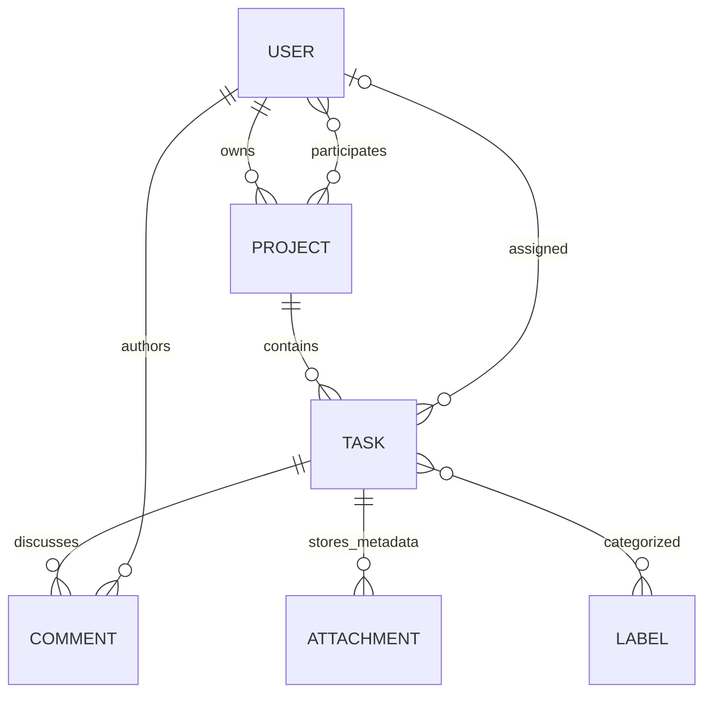

# Architecture and code walkthrough

[README](../README.md) · [API](API.md) · [Operations](OPERATIONS.md) · [Course checklist](COURSE_CHECKLIST.md)

## Design

One Spring Boot application and one relational database implement the assignment.
Controllers handle HTTP, services enforce business rules inside transactions,
repositories access data, and MapStruct converts entities into response records.
There are no module ports, planning engines or alternate storage providers.

| Package | Responsibility | Start reading |
|---|---|---|
| `controller` | Validated HTTP requests, status codes and authenticated actor IDs | [TaskController](../src/main/java/com/example/taskmanagement/controller/TaskController.java) |
| `service` | Interfaces + `*ServiceImpl` for CRUD, authorization and integrations | [TaskService](../src/main/java/com/example/taskmanagement/service/TaskService.java) / [TaskServiceImpl](../src/main/java/com/example/taskmanagement/service/TaskServiceImpl.java) |
| `repository` | Spring Data queries, pagination and project locking | [TaskRepository](../src/main/java/com/example/taskmanagement/repository/TaskRepository.java) |
| `model` | Six JPA entities and assignment enums | [Task](../src/main/java/com/example/taskmanagement/model/Task.java) |
| `dto` | Validated requests, filters and response records | [TaskRequest](../src/main/java/com/example/taskmanagement/dto/TaskRequest.java) |
| `mapper` | Compile-time entity/DTO transformations | [ResponseMapper](../src/main/java/com/example/taskmanagement/mapper/ResponseMapper.java) |
| `security` | JWT validation, live roles and BCrypt login | [SecurityConfig](../src/main/java/com/example/taskmanagement/security/SecurityConfig.java) |
| `config` | UTC clock, Dropbox client, async email and OpenAPI | [ApplicationConfig](../src/main/java/com/example/taskmanagement/config/ApplicationConfig.java) |
| `exception` | Custom API exceptions and Problem Detail mapping | [GlobalExceptionHandler](../src/main/java/com/example/taskmanagement/exception/GlobalExceptionHandler.java) |

## Custom API exceptions

Services throw typed `ApiException` subclasses instead of Spring's
`ResponseStatusException`. Each subclass carries an `HttpStatus` and a stable
message. HTTP clients receive RFC 7807 `ProblemDetail` JSON.

| Exception | HTTP status | Typical use |
|---|---|---|
| `BadRequestException` | 400 | Validation/business input errors |
| `UnauthorizedException` | 401 | Invalid login credentials |
| `ForbiddenException` | 403 | Missing owner/admin rights |
| `NotFoundException` | 404 | Missing entity for the caller |
| `ConflictException` | 409 | Unique/state conflicts |
| `PayloadTooLargeException` | 413 | Attachment ZIP page over 25 MiB |
| `BadGatewayException` | 502 | Dropbox provider failures |

### Why exception classes do not use Lombok

Handwritten get/set (and Lombok `@Getter`/`@Setter`) are unnecessary on these
types. They are small immutable failure values, not mutable beans.

| Piece | What it holds | Why Lombok is not needed |
|---|---|---|
| `ApiException` | `final HttpStatus status` + message via `RuntimeException` | One field; a single `getStatus()` is clearer than a class-level annotation. Message already has `getMessage()` from the JDK. |
| Seven subclasses | Only call `super(HttpStatus.…, message)` | No extra fields → nothing to generate getters/setters for. |
| Setters | — | Status and message must not change after construction; setters would invite mutation of a thrown error. |
| `@RequiredArgsConstructor` / `@Data` | — | Construction already encodes status in each subclass constructor. `@Data` would add mutable-style `equals`/`hashCode` noise that exceptions should not rely on. |

Optional `@Getter` on `ApiException` alone would only replace the existing
`getStatus()` method; it adds no clarity here, so the project keeps the explicit
method. Controllers/services use Lombok for DI and entities; exception types stay
plain Java.

### How `GlobalExceptionHandler` intercepts exceptions

Controllers stay thin: they call services and do not wrap every failure in
`try/catch`. When a service throws, the exception propagates out of the
controller method. Spring MVC then looks for an `@ExceptionHandler` that can
handle that type.

`GlobalExceptionHandler` is a `@RestControllerAdvice` bean (extends
`ResponseEntityExceptionHandler`). Advice applies to all `@RestController`
endpoints in the application. Spring registers each `@ExceptionHandler` method
as a resolver for the declared exception type(s).

Request flow:

1. Filter chain / DispatcherServlet invokes the controller.
2. The service throws, for example, `new NotFoundException("Task not found")`.
3. DispatcherServlet does not return a normal body; it asks exception resolvers.
4. The resolver matches `NotFoundException` to `@ExceptionHandler(ApiException.class)`
   because every custom domain exception **extends** `ApiException` (subtype match).
5. `apiFailure` builds `ProblemDetail.forStatusAndDetail(status, message)`.
6. With `spring.mvc.problemdetails.enabled=true`, the response is
   `application/problem+json` and the HTTP status comes from the problem's status.

```java
@RestControllerAdvice
public class GlobalExceptionHandler extends ResponseEntityExceptionHandler {
    @ExceptionHandler(ApiException.class)
    public ProblemDetail apiFailure(ApiException exception) {
        return ProblemDetail.forStatusAndDetail(
                exception.getStatus(), exception.getMessage());
    }
}
```

One handler covers all seven subclasses. There is no need for a separate
`@ExceptionHandler` per status class unless the response shape differs.

Additional handlers on the same advice catch infrastructure failures that are
not `ApiException`:

| Trigger | Status | Detail |
|---|---|---|
| `PropertyReferenceException` | 400 | Unknown sort field |
| `DataIntegrityViolationException` / optimistic lock | 409 | Concurrent or unique conflict |
| `IOException` | 502 | File transfer failed |

`ResponseEntityExceptionHandler` (the superclass) already maps many Spring MVC
errors (for example Bean Validation / malformed JSON) into problem responses.
Our advice only adds the domain and infrastructure cases above.

**Not intercepted here:** failures stopped in the security filter chain before
the controller runs (missing/invalid JWT). Those never reach
`GlobalExceptionHandler`; Spring Security answers with 401/403 itself.

See
[GlobalExceptionHandler.java](../src/main/java/com/example/taskmanagement/exception/GlobalExceptionHandler.java).

## Data model



Project membership and task labels use join tables. Entities use lazy associations
and optimistic `version` fields; DTOs expose association IDs rather than persistence
objects. Comments and attachments use `LocalDateTime` interpreted as UTC. Project
dates and task due dates use `LocalDate`.

[The initial YAML changelog](../src/main/resources/db/changelog/001-course-schema.yaml)
(`course-001`, included from
[db.changelog-master.yaml](../src/main/resources/db/changelog/db.changelog-master.yaml))
defines tables, foreign keys, uniqueness and retrieval indexes with Liquibase
`createTable` / `createIndex` change types. Enum and date-range checks use small
`sql` ALTER statements because community Liquibase does not ship
`addCheckConstraint`. Both application tables and Liquibase tracking are in
`public`; Hibernate validates the schema instead of changing it at startup.

## MapStruct in practice

[ResponseMapper](../src/main/java/com/example/taskmanagement/mapper/ResponseMapper.java)
is a MapStruct interface injected into the services as a Spring bean. Maven runs
`mapstruct-processor` during compilation and generates `ResponseMapperImpl` under
`target/generated-sources/annotations`. Generated sources are build output.

```java
@Mapper(componentModel = MappingConstants.ComponentModel.SPRING,
        unmappedTargetPolicy = ReportingPolicy.ERROR)
public interface ResponseMapper {
    @Mapping(target = "projectId", source = "project.id")
    @Mapping(target = "assigneeId", source = "assignee.id")
    @Mapping(target = "labelIds", source = "labels")
    TaskResponse toResponse(Task task);
}
```

The complete mapper demonstrates:

- Convention-based mapping into Java records for all six response types.
- Nested association flattening, including a nullable task assignee.
- Generated collection conversion from project members/task labels to ID sets,
  using small typed element conversion methods.
- `LabelRequest → Label` creation with a qualified `@Named` name normalizer.
- `@MappingTarget` updates of an existing label; ID/version are explicitly ignored
  so JPA identity and optimistic locking remain under persistence control.
- `ReportingPolicy.ERROR`, which makes unmapped response/entity target properties
  fail compilation instead of silently disappearing.

Services still decide access, load referenced entities, hash passwords and publish
notifications. These decisions are not hidden inside mapper callbacks. Mapping
runs within service transactions, before lazy entity associations are detached.

To inspect the generated implementation:

```powershell
.\mvnw.cmd clean compile
Get-Content target/generated-sources/annotations/com/example/taskmanagement/mapper/ResponseMapperImpl.java
```

If an IDE cannot resolve the generated bean, reimport the Maven project, enable
annotation processing and run the Maven compile goal. The configuration follows
[MapStruct's official Maven setup](https://mapstruct.org/documentation/stable/reference/html/#_apache_maven).

## Lombok constructors — rule and exceptions

Spring DI beans use constructor injection. Where the constructor only assigns
`final` dependencies, the project uses Lombok
[`@RequiredArgsConstructor`](https://projectlombok.org/features/RequiredArgsConstructor)
instead of a handwritten constructor. Controllers and most `*ServiceImpl`
classes follow that pattern. Maven runs Lombok before MapStruct via
`lombok-mapstruct-binding`. Domain services expose an interface
(`UserService`, `ProjectService`, …) and a Spring `@Service` implementation
(`UserServiceImpl`, …); controllers and collaborating services depend on the
interface.

**Do not** put Lombok on JPA entities for this purpose. Entities keep an explicit
no-arg constructor (and ordinary accessors) so Hibernate can instantiate and
hydrate them. That is unrelated to Spring DI.

Two Spring beans intentionally keep handwritten constructors.

### 1. `JwtService` — constructor body is not a pure assignment

```java
public JwtService(UserRepository users, PasswordEncoder passwords,
        JwtEncoder encoder, Clock clock) {
    this.users = users;
    this.passwords = passwords;
    this.encoder = encoder;
    this.clock = clock;
    this.dummyHash = passwords.encode("invalid-login-timing-placeholder");
}
```

`@RequiredArgsConstructor` would only write `this.field = field` for each
`final` dependency. Here `dummyHash` is derived during construction: a BCrypt
hash used on failed logins so password checks take a similar amount of time
whether the username exists or not (timing side-channel mitigation).

That value depends on the injected `PasswordEncoder` and must be computed once
when the bean is created. Lombok cannot express “call `passwords.encode(...)` in
the generated constructor”, so a handwritten constructor remains the clear,
reviewable choice. Refactors that move the hash into a lazy getter or
`@PostConstruct` would change when the work runs; they are not required for
correctness and would obscure the security intent.

See [JwtService](../src/main/java/com/example/taskmanagement/security/JwtService.java).

### 2. `EmailServiceImpl` — `@Value` must stay on the constructor parameter

```java
public EmailServiceImpl(JavaMailSender sender, @Value("${notification.from}") String from) {
    this.sender = sender;
    this.from = from;
}
```

Spring resolves `@Value` (and similar annotations) on **injection points** it
sees: constructor parameters, setter parameters or fields it injects itself.
`@RequiredArgsConstructor` generates a constructor **without** copying
parameter annotations from fields. Putting `@Value` on a `final` field while
letting Lombok generate the constructor does not reliably place `@Value` on the
generated parameter, so the `from` address would not be injected as intended.

Keeping an explicit constructor with `@Value` on the `from` parameter preserves
constructor injection and makes the configuration key visible at the injection
point. Alternatives (`@ConfigurationProperties`, a dedicated settings bean) are
valid but heavier than this one-line property.

See [EmailServiceImpl](../src/main/java/com/example/taskmanagement/service/EmailServiceImpl.java).

**Rule of thumb:** use `@RequiredArgsConstructor` when the constructor would be
only field assignments; keep a handwritten constructor when it contains logic or
parameter annotations Spring must process.

### JPA entities use `@Getter` / `@Setter` / `@NoArgsConstructor`

The six entities (`User`, `Project`, `Task`, `Comment`, `Attachment`, `Label`)
use Lombok accessors instead of handwritten get/set methods:

```java
@Getter
@Setter
@NoArgsConstructor
@Entity
public class User {
    @Id
    @GeneratedValue(strategy = GenerationType.IDENTITY)
    @Setter(AccessLevel.NONE)
    private Long id;

    @Version
    @Setter(AccessLevel.NONE)
    private long version;
    // remaining fields keep class-level @Getter/@Setter
}
```

Do **not** use `@Data` on entities: it generates `equals`/`hashCode`/`toString`
from mutable fields and associations, which is unsafe for JPA. `id` and
`version` keep `@Setter(AccessLevel.NONE)` so identity and optimistic locking
stay under persistence control.

Custom `ApiException` types also skip Lombok accessors; see
[Why exception classes do not use Lombok](#why-exception-classes-do-not-use-lombok).

## OpenAPI / Swagger special cases

`ApplicationConfig` registers a global JWT `bearerAuth` scheme and applies it to
every operation by default. Controllers add `@Tag`, `@Operation`, `@ApiResponses`
and `@Parameter` so Swagger UI shows purpose, auth and real HTTP statuses.

Two annotation patterns are easy to get wrong. They are documented here because
they affect how reviewers and students use Swagger, not only how the JSON looks.

### 1. Hide the JWT method argument

Authenticated handlers take `@AuthenticationPrincipal Jwt jwt`. That argument is
injected by Spring Security after the `Authorization: Bearer …` header is
validated. It is **not** part of the public HTTP contract: clients never paste a
JWT object into a request body or query field.

Without `@Parameter(hidden = true)`, springdoc may render an extra Swagger input
named like `jwt`. Operators then try to fill it manually and confuse it with the
**Authorize** dialog. Hide the principal everywhere it appears:

```java
public UserResponse profile(
        @Parameter(hidden = true) @AuthenticationPrincipal Jwt jwt) {
    return users.profile(Long.valueOf(jwt.getSubject()));
}
```

Rule of thumb: hide framework types the client does not send (`Jwt`,
`Principal`, servlet request/response). Keep visible parameters for path, query,
header and body fields that belong to the API.

Public auth endpoints do the opposite for **security**, not for parameters:
`@Operation(security = {})` clears the global bearer requirement so register/login
do not show a lock in Swagger.

### 2. Describe files as `string` + `format = binary`

JSON request/response models use ordinary schemas (`UserResponse`, `TaskRequest`).
File upload and download are raw bytes. OpenAPI represents binary payloads as
`type: string` with `format: binary`.

**Upload** uses `multipart/form-data`. The file part must be annotated so Swagger
shows a **Choose file** control instead of a JSON text box:

```java
@PostMapping(consumes = MediaType.MULTIPART_FORM_DATA_VALUE)
public ResponseEntity<AttachmentResponse> upload(
        @Parameter(hidden = true) @AuthenticationPrincipal Jwt jwt,
        @RequestParam Long taskId,
        @Parameter(description = "File to upload (1 B to 5 MB)", required = true,
                content = @Content(
                        mediaType = MediaType.APPLICATION_OCTET_STREAM_VALUE,
                        schema = @Schema(type = "string", format = "binary")))
        @RequestParam MultipartFile file) { ... }
```

**Download / ZIP** declare the same binary schema on the success `@ApiResponse`
content (`application/octet-stream` or `application/zip`). Otherwise the UI
implies a JSON string body while the server streams file bytes.

See [AttachmentController](../src/main/java/com/example/taskmanagement/controller/AttachmentController.java)
for upload, single-file download and paginated ZIP responses, and
[AuthController](../src/main/java/com/example/taskmanagement/controller/AuthController.java)
for public operations with empty security.

## Follow a task assignment

1. Spring Security validates the JWT and loads the current user role from the database.
2. `TaskController` validates a `TaskRequest` and passes the authenticated ID to `TaskService`.
3. The service locks the project row and rechecks access and assignment membership.
4. JPA saves the task. MapStruct produces the response DTO within the transaction.
5. An assignment event is delivered asynchronously by `EmailService` after commit.

## Transactions and concurrency

Write services are transactional; read operations use read-only transactions.
Mutations of project membership, task assignment and task-owned content share a
project row lock. A concurrent assignment therefore checks membership after a
membership-removal transaction commits. A controlled two-worker integration test
exercises this invariant on both H2 and PostgreSQL.

Optimistic versions detect conflicting entity changes. They are internal persistence
fields, not client-supplied version commands. Project status is manually editable;
it does not calculate task status. Task status follows the three assignment values
and is editable through ordinary PUT.

## External side effects

Dropbox stores file bytes; PostgreSQL stores the provider ID and metadata. The SDK
adapter retrieves/deletes by ID. Failed metadata saves attempt upload cleanup.
A failed provider deletion retains metadata; provider-not-found permits a safe
retry. Dropbox and PostgreSQL do not share an atomic transaction, so a failure at
the provider/database boundary can still require operational reconciliation.

Assignment/comment/reminder events trigger after-commit asynchronous email.
SMTP failure is logged without recipient/content/credentials and does not roll
back committed application data. No durable outbox or retry subsystem is present.
Daily reminders target only the assignee at 09:00 UTC, on the previous/due day,
excluding completed or unassigned tasks. This assumes one running application.

## Verification boundaries

The [persistence audit](CODE_REVIEW.md#relationship-ownership) records every owning
side, cascade choice and measured fetch plan. The [Spring lifecycle guide](SPRING_LIFECYCLE.md)
explains singleton scopes, constructor/factory dependencies and container initialization.

HTTP integration tests exercise authentication, authorization, JPA, Liquibase,
mapped responses and rollback behavior. Adapter tests substitute the Dropbox SDK
client; mail tests substitute SMTP. CI adds real PostgreSQL and jar/container
startup/restart. These checks do not establish live-provider acceptance, measured
scalability or automatic deployment.
