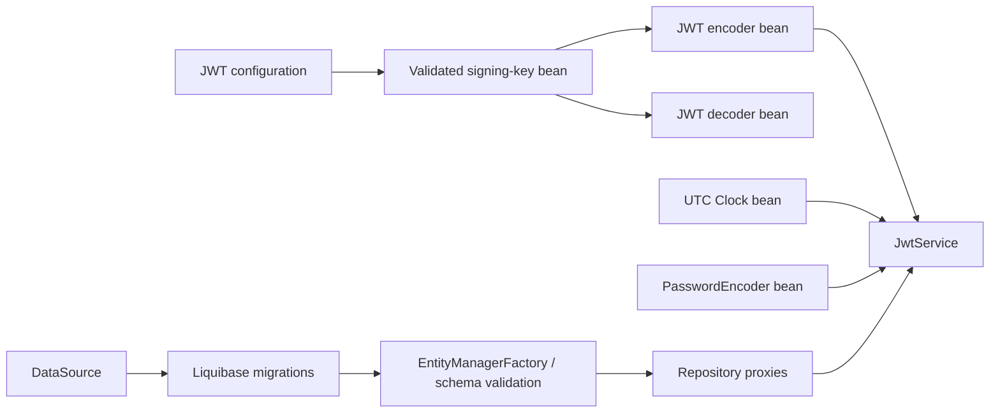

# Spring bean lifecycle and scope choices

[README](../README.md) · [Architecture](ARCHITECTURE.md) · [Code review](CODE_REVIEW.md)

## Initialization is a dependency graph

Constructor parameters and @Bean method arguments declare the actual dependencies.
Spring initializes those dependencies before their consumers. Unrelated beans do
not require an artificial global initialization sequence.



[SecurityConfig](../src/main/java/com/example/taskmanagement/security/SecurityConfig.java)
validates one signing-key bean and supplies it to both the encoder and decoder.
JwtService receives the encoder through constructor injection; it does not create
an unmanaged encoder or resolve dependencies through ApplicationContext.

```java
@Bean
public JwtEncoder jwtEncoder(SecretKeySpec jwtSigningKey) {
    return new NimbusJwtEncoder(new ImmutableSecret<>(jwtSigningKey));
}
```

Invalid JWT configuration fails during bean creation. Constructors do not query
projects, call Dropbox, send mail or start their own threads. JwtService builds
one BCrypt dummy hash to make missing-account login work comparable to normal login.

Boot coordinates Liquibase before JPA schema validation. With ddl-auto=validate,
Hibernate cannot silently create missing tables. The lifecycle test verifies the
initialized migration and usable JPA factory; packaged/container restart checks
exercise the complete startup path.

## Scope decisions

Spring singleton means one instance per application context, not a global Java
singleton. Singleton scope does not itself make mutable state thread-safe.

| Component | Scope | Why it fits |
|---|---|---|
| Controllers and CRUD services | Default singleton | Actor IDs, entities and results remain local to operations |
| MapStruct mapper | Default singleton | Generated conversion has no per-request mutable fields |
| Repository proxies | Default singleton | Spring routes work to transaction-bound persistence contexts |
| JWT encoder/decoder/key | Singleton @Bean | Shared configured infrastructure initialized before consumers |
| Clock and PasswordEncoder | Singleton @Bean | Reusable dependencies that retain no request data |
| Dropbox client and JavaMailSender | Managed singleton infrastructure | Configured clients are reused; streams/messages remain local |
| Scheduler and email listener | Default singleton | Work uses local data and immutable event payloads |

No prototype beans are declared. Mutable DTOs, entities, mail messages and upload
streams are ordinary per-operation objects, not Spring prototype definitions.
There is no conversational service state that needs a new managed instance per use.

A prototype injected directly into a singleton constructor is resolved once. A real
future need for repeated prototype instances would require a provider/lookup and
caller-owned cleanup; Spring does not automatically destroy prototype instances.
That lifecycle is unnecessary for the current task flows.

## Factory configuration and AOP

Both configuration classes use @Configuration(proxyBeanMethods = false). Factory
methods receive dependencies as arguments and do not directly call other factory
methods. Sharing therefore does not depend on configuration-class interception.

Business AOP is separate from configuration-class proxying:

- External service calls use Spring's transaction proxies.
- EmailService has async advice; events are delivered after database commit.
- Repository proxies handle persistence integration.
- Internal helper calls execute in the existing public operation's transaction;
  they are not expected to open a new transaction through self-invocation.
- No initialization callback invokes a transactional operation expecting an AOP
  proxy to be active, and no use case manually constructs another service.

No application @DependsOn, @Order or @PostConstruct callback is needed here.
Ordering annotations would not replace the declared dependency graph.

## Async work and shutdown

TaskEmail carries copied strings, not JPA entities or a request security context.
The worker does not access a closed persistence context or rely on the caller's
authentication thread-local. Every send creates a fresh local SimpleMailMessage.

Boot owns executor/scheduler, DataSource and EntityManagerFactory lifecycles and
closes managed infrastructure at context shutdown. Streams and Dropbox download
handles use try-with-resources. No application-owned prototype resource needs a
custom destruction callback. In-flight delivery remains best effort.

## Executable evidence

[BeanLifecycleTest](../src/test/java/com/example/taskmanagement/BeanLifecycleTest.java)
verifies shared instances, transaction/async/repository proxies, dependency metadata
for key → encoder/decoder → JwtService, and schema initialization before JPA use.
Login, notification and concurrency tests exercise the resulting wiring.

References: [Spring scopes](https://docs.spring.io/spring-framework/reference/core/beans/factory-scopes.html),
[dependency injection](https://docs.spring.io/spring-framework/reference/core/beans/dependencies/factory-collaborators.html),
[Java configuration](https://docs.spring.io/spring-framework/reference/core/beans/java/bean-annotation.html)
and [lifecycle callbacks](https://docs.spring.io/spring-framework/reference/core/beans/factory-nature.html).
